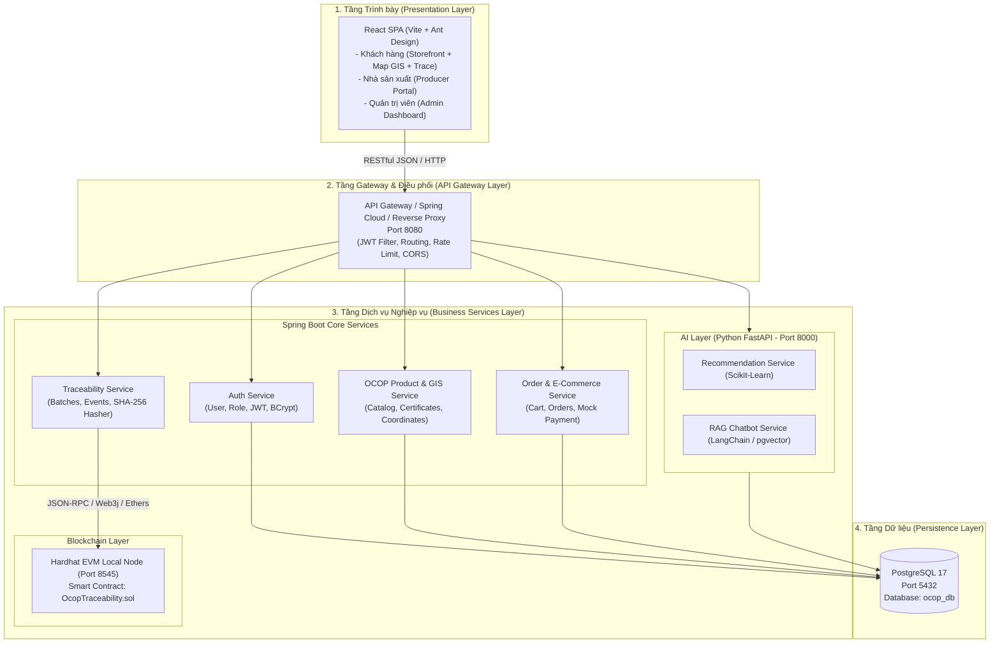
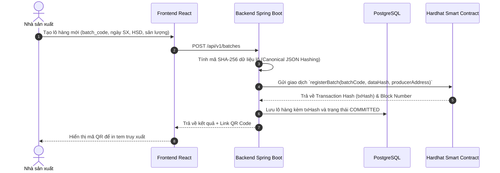
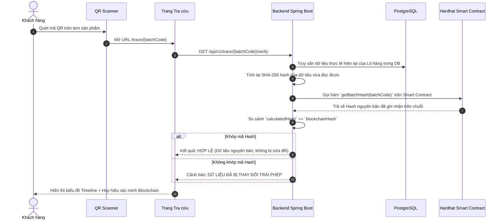

# KIẾN TRÚC HỆ THỐNG (SYSTEM ARCHITECTURE)

**Đề tài**: Xây dựng nền tảng thương mại điện tử và xúc tiến thương mại sản phẩm OCOP tích hợp Blockchain truy xuất nguồn gốc và AI gợi ý đặc sản vùng miền  
**Mã tài liệu**: ARCH-OCOP-01  
**Phiên bản**: 1.0.0  

---

## 1. Phong cách Kiến trúc (Architectural Style)

Hệ thống được thiết kế theo mô hình **Service-Oriented / Pragmatic Microservices**, tối ưu hóa cho đồ án tốt nghiệp trong 9 tuần, cân bằng giữa việc phân chia ranh giới nghiệp vụ sạch sẽ và khả năng vận hành ổn định trên máy tính cá nhân.

---

## 2. Ranh giới Phân chia Dịch vụ (Bounded Contexts)

1. **Frontend Web (React + Ant Design)**:
   - Giao diện SPA hiện đại, responsive trên desktop và mobile web.
   - Thư viện hiển thị bản đồ GIS: `leaflet` và `react-leaflet`.
   - Thư viện đọc và quét QR Code: `html5-qrcode`.

2. **Backend Core (Java Spring Boot 3.x)**:
   - Quản lý logic nghiệp vụ cốt lõi, quy tắc toàn vẹn dữ liệu, giao dịch database và xác thực người dùng.
   - Kết nối cơ sở dữ liệu qua **Spring Data JPA / Hibernate**.
   - Tài liệu API tự động qua **SpringDoc OpenAPI 3 (Swagger UI)**.

3. **Blockchain Node (Hardhat & Solidity)**:
   - Khởi chạy một mạng Ethereum ảo cục bộ (Local EVM) tại `http://127.0.0.1:8545`.
   - Hợp đồng thông minh `OcopTraceability.sol` chỉ lưu trữ:
     - `batchCode`: Khóa định danh lô hàng.
     - `dataHash`: Mã SHA-256 của thông tin lô và các chứng từ kiểm định.
     - `events`: Danh sách các mốc thời gian và mã băm của từng công đoạn sản xuất.
     - `timestamp`: Thời điểm ghi nhận bất biến trên mạng phân tán.

4. **AI Service (Python 3.11 + FastAPI)** *(Triển khai ở Tuần 7 - 8)*:
   - Tách biệt service Python để tận dụng tối đa thư viện Machine Learning và NLP mà không làm nặng backend Java.
   - Tương tác với Backend thông qua REST API chuẩn JSON.

---

## 3. Luồng Hoạt động Tiêu biểu (Key Workflows)

### 3.1. Luồng Ghi nhận Lô hàng & Đưa mã Băm lên Blockchain

### 3.2. Luồng Người tiêu dùng Quét QR & Kiểm tra Tính Toàn vẹn (Integrity Verification)

---

## 4. Quản lý Môi trường & Biến Cấu hình

Tất cả cấu hình quan trọng (database credentials, JWT secret, cổng dịch vụ) được quản lý qua biến môi trường hoặc file `application.yml`:
- Không commit private key thực hoặc mật khẩu nhạy cảm lên Git public.
- Môi trường phát triển cục bộ (Local Development) được tối ưu để chỉ cần chạy lệnh là có thể hoạt động mà không phụ thuộc hạ tầng đám mây tốn phí.
