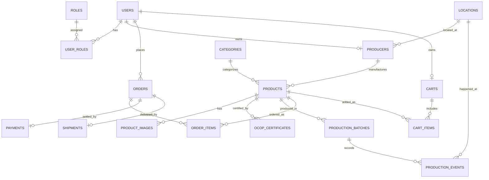

# THIẾT KẾ CƠ SỞ DỮ LIỆU (DATABASE DESIGN)

**Đề tài**: Xây dựng nền tảng thương mại điện tử và xúc tiến thương mại sản phẩm OCOP tích hợp Blockchain truy xuất nguồn gốc và AI gợi ý đặc sản vùng miền  
**Hệ quản trị CSDL**: PostgreSQL 17  
**Database Name**: `ocop_db`  
**Mã tài liệu**: DB-OCOP-01  

---

## 1. Sơ đồ Thực thể - Mối quan hệ (Entity Relationship Diagram - ERD)

---

## 2. Chi tiết Cấu trúc Bảng (Table Schemas)

### Nhóm 1: Quản trị Người dùng & Phân quyền

#### Bảng `users`
| Cột | Kiểu dữ liệu | Ràng buộc | Mô tả |
| :--- | :--- | :--- | :--- |
| `id` | BIGSERIAL | PRIMARY KEY | Định danh người dùng |
| `username` | VARCHAR(50) | UNIQUE, NOT NULL | Tên đăng nhập |
| `email` | VARCHAR(100) | UNIQUE, NOT NULL | Địa chỉ email |
| `password_hash` | VARCHAR(255) | NOT NULL | Mật khẩu băm (BCrypt) |
| `full_name` | VARCHAR(100) | NOT NULL | Họ và tên |
| `phone` | VARCHAR(20) | NULL | Số điện thoại |
| `avatar_url` | VARCHAR(255) | NULL | Đường dẫn ảnh đại diện |
| `status` | VARCHAR(20) | DEFAULT 'ACTIVE' | ACTIVE, INACTIVE, BLOCKED |
| `created_at` | TIMESTAMP | DEFAULT CURRENT_TIMESTAMP | Ngày tạo |
| `updated_at` | TIMESTAMP | DEFAULT CURRENT_TIMESTAMP | Ngày cập nhật |

#### Bảng `roles` & `user_roles`
- `roles`: `id` (SERIAL, PK), `name` (VARCHAR(50), UNIQUE - ví dụ: `ROLE_CUSTOMER`, `ROLE_PRODUCER`, `ROLE_ADMIN`).
- `user_roles`: `user_id` (FK -> users.id), `role_id` (FK -> roles.id), PK (`user_id`, `role_id`).

---

### Nhóm 2: Nhà sản xuất, Địa lý (GIS) & Sản phẩm OCOP

#### Bảng `locations`
| Cột | Kiểu dữ liệu | Ràng buộc | Mô tả |
| :--- | :--- | :--- | :--- |
| `id` | BIGSERIAL | PRIMARY KEY | Định danh vị trí |
| `province` | VARCHAR(100) | NOT NULL | Tỉnh / Thành phố (ví dụ: Hà Giang, Bến Tre) |
| `district` | VARCHAR(100) | NULL | Quận / Huyện / Thị xã |
| `ward` | VARCHAR(100) | NULL | Phường / Xã / Thị trấn |
| `address_detail` | VARCHAR(255) | NULL | Địa chỉ cụ thể (thôn, bản, số nhà) |
| `latitude` | NUMERIC(10, 7) | NOT NULL | Vĩ độ địa lý (cho GIS Leaflet) |
| `longitude` | NUMERIC(10, 7) | NOT NULL | Kinh độ địa lý (cho GIS Leaflet) |

#### Bảng `producers`
| Cột | Kiểu dữ liệu | Ràng buộc | Mô tả |
| :--- | :--- | :--- | :--- |
| `id` | BIGSERIAL | PRIMARY KEY | Định danh nhà sản xuất |
| `user_id` | BIGINT | UNIQUE, FK -> users(id) | Tài khoản đại diện của HTX/Doanh nghiệp |
| `name` | VARCHAR(150) | NOT NULL | Tên Hợp tác xã / Cơ sở sản xuất |
| `code` | VARCHAR(50) | UNIQUE, NOT NULL | Mã định danh cơ sở |
| `description` | TEXT | NULL | Giới thiệu năng lực, lịch sử làng nghề |
| `location_id` | BIGINT | FK -> locations(id) | Tọa độ và địa chỉ trụ sở |
| `contact_email`| VARCHAR(100) | NULL | Email liên hệ |
| `phone` | VARCHAR(20) | NULL | Hotline liên hệ |
| `is_verified` | BOOLEAN | DEFAULT FALSE | Quản trị viên duyệt xác minh |

#### Bảng `categories`
- `id` (BIGSERIAL, PK), `name` (VARCHAR(100), NOT NULL), `slug` (VARCHAR(100), UNIQUE), `description` (TEXT), `icon_url` (VARCHAR(255)).

#### Bảng `products`
| Cột | Kiểu dữ liệu | Ràng buộc | Mô tả |
| :--- | :--- | :--- | :--- |
| `id` | BIGSERIAL | PRIMARY KEY | Định danh sản phẩm |
| `producer_id` | BIGINT | NOT NULL, FK -> producers(id) | Đơn vị sản xuất |
| `category_id` | BIGINT | NOT NULL, FK -> categories(id) | Phân loại sản phẩm |
| `name` | VARCHAR(200) | NOT NULL | Tên sản phẩm OCOP |
| `slug` | VARCHAR(220) | UNIQUE, NOT NULL | Đường dẫn thân thiện SEO |
| `description` | TEXT | NOT NULL | Mô tả chi tiết sản phẩm |
| `cultural_story`| TEXT | NULL | Câu chuyện văn hóa, bản sắc vùng miền |
| `price` | NUMERIC(12, 2) | NOT NULL | Giá bán niêm yết (VNĐ) |
| `stock_quantity`| INT | DEFAULT 0 | Số lượng tồn kho |
| `unit` | VARCHAR(30) | DEFAULT 'Hộp' | Đơn vị tính (Hộp, Kg, Chai, Gói...) |
| `ocop_star_rating`| SMALLINT | CHECK (ocop_star_rating BETWEEN 3 AND 5) | Hạng sao OCOP (3, 4 hoặc 5 sao) |
| `thumbnail` | VARCHAR(255) | NULL | Ảnh đại diện chính |
| `status` | VARCHAR(20) | DEFAULT 'ACTIVE' | ACTIVE, HIDDEN, OUT_OF_STOCK |
| `created_at` | TIMESTAMP | DEFAULT CURRENT_TIMESTAMP | Ngày tạo |
| `updated_at` | TIMESTAMP | DEFAULT CURRENT_TIMESTAMP | Ngày cập nhật |

#### Bảng `ocop_certificates`
- `id` (BIGSERIAL, PK), `product_id` (FK -> products.id), `certificate_code` (VARCHAR(50), NOT NULL), `star_rating` (SMALLINT), `issued_date` (DATE), `expiry_date` (DATE), `issuing_authority` (VARCHAR(150)), `document_url` (VARCHAR(255)), `is_sample_data` (BOOLEAN DEFAULT TRUE - Ghi chú rõ dữ liệu mẫu).

---

### Nhóm 3: Lô sản xuất & Dấu vết Blockchain

#### Bảng `production_batches`
| Cột | Kiểu dữ liệu | Ràng buộc | Mô tả |
| :--- | :--- | :--- | :--- |
| `id` | BIGSERIAL | PRIMARY KEY | Định danh lô sản xuất |
| `product_id` | BIGINT | NOT NULL, FK -> products(id) | Sản phẩm thuộc lô |
| `batch_code` | VARCHAR(50) | UNIQUE, NOT NULL | Mã lô (ví dụ: `BATCH-2026-CHEMS-01`) |
| `manufacture_date`| DATE | NOT NULL | Ngày sản xuất |
| `expiry_date` | DATE | NOT NULL | Hạn sử dụng |
| `quantity` | INT | NOT NULL | Số lượng sản phẩm xuất xưởng |
| `qr_code_url` | VARCHAR(255) | NULL | URL ảnh QR Code tra cứu |
| `raw_data_hash`| VARCHAR(66) | NOT NULL | Chuỗi băm SHA-256 dữ liệu gốc |
| `blockchain_tx_hash`| VARCHAR(66)| NULL | Hash giao dịch xác nhận trên Smart Contract |
| `blockchain_status`| VARCHAR(20)| DEFAULT 'PENDING' | PENDING, COMMITTED, FAILED |
| `created_at` | TIMESTAMP | DEFAULT CURRENT_TIMESTAMP | Ngày tạo |

#### Bảng `production_events`
| Cột | Kiểu dữ liệu | Ràng buộc | Mô tả |
| :--- | :--- | :--- | :--- |
| `id` | BIGSERIAL | PRIMARY KEY | Định danh sự kiện truy xuất |
| `batch_id` | BIGINT | NOT NULL, FK -> production_batches(id) | Lô sản xuất liên quan |
| `event_type` | VARCHAR(30) | NOT NULL | `HARVEST`, `PROCESSING`, `PACKAGING`, `QUALITY_CHECK`, `SHIPPING` |
| `event_name` | VARCHAR(150) | NOT NULL | Tên sự kiện (ví dụ: "Thu hoạch trà nõn tôm") |
| `description` | TEXT | NULL | Ghi chép kỹ thuật, độ ẩm, nhiệt độ |
| `actor_name` | VARCHAR(100) | NOT NULL | Người/Bộ phận thực hiện |
| `location_id` | BIGINT | NULL, FK -> locations(id) | Địa điểm diễn ra sự kiện |
| `event_timestamp`| TIMESTAMP | NOT NULL | Thời điểm diễn ra sự kiện |
| `raw_data_hash`| VARCHAR(66) | NOT NULL | SHA-256 hash của sự kiện |
| `blockchain_tx_hash`| VARCHAR(66)| NULL | Hash giao dịch ghi sự kiện lên Smart Contract |
| `created_at` | TIMESTAMP | DEFAULT CURRENT_TIMESTAMP | Ngày ghi nhận vào DB |

---

### Nhóm 4: Thương mại điện tử (Đơn hàng & Giỏ hàng)

- `carts`: `id` (BIGSERIAL, PK), `user_id` (BIGINT, UNIQUE, FK -> users.id).
- `cart_items`: `id` (BIGSERIAL, PK), `cart_id` (FK -> carts.id), `product_id` (FK -> products.id), `quantity` (INT, NOT NULL).
- `orders`: `id` (BIGSERIAL, PK), `order_code` (VARCHAR(30), UNIQUE), `user_id` (FK -> users.id), `total_amount` (NUMERIC(12,2)), `shipping_fee` (NUMERIC(12,2)), `status` (`PENDING`, `CONFIRMED`, `SHIPPING`, `DELIVERED`, `CANCELLED`), `shipping_address` (TEXT), `recipient_name` (VARCHAR(100)), `recipient_phone` (VARCHAR(20)), `note` (TEXT), `created_at` (TIMESTAMP).
- `order_items`: `id` (BIGSERIAL, PK), `order_id` (FK -> orders.id), `product_id` (FK -> products.id), `product_name` (VARCHAR(200)), `quantity` (INT), `unit_price` (NUMERIC(12,2)), `total_price` (NUMERIC(12,2)).
- `payments`: `id` (BIGSERIAL, PK), `order_id` (FK -> orders.id), `payment_method` (`MOCK_VNPAY`, `MOCK_MOMO`, `COD`), `amount` (NUMERIC(12,2)), `status` (`SUCCESS`, `PENDING`, `FAILED`), `transaction_ref` (VARCHAR(100)), `payment_time` (TIMESTAMP).
- `shipments`: `id` (BIGSERIAL, PK), `order_id` (FK -> orders.id), `tracking_code` (VARCHAR(50)), `carrier_name` (VARCHAR(100)), `status` (`PREPARING`, `IN_TRANSIT`, `DELIVERED`), `updated_at` (TIMESTAMP).
